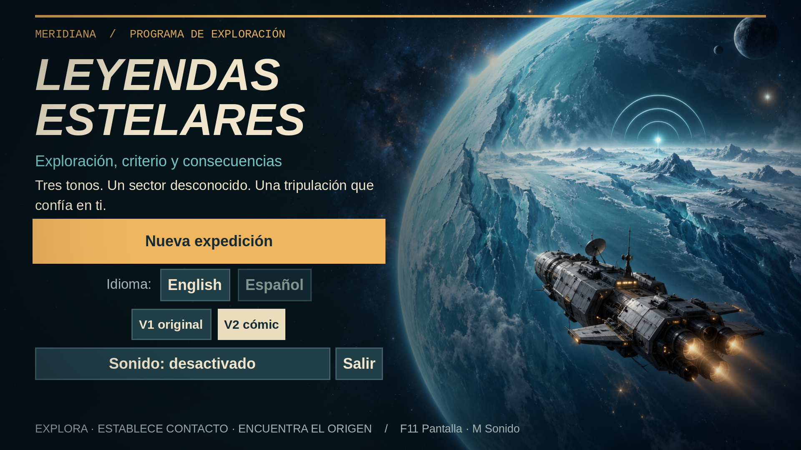
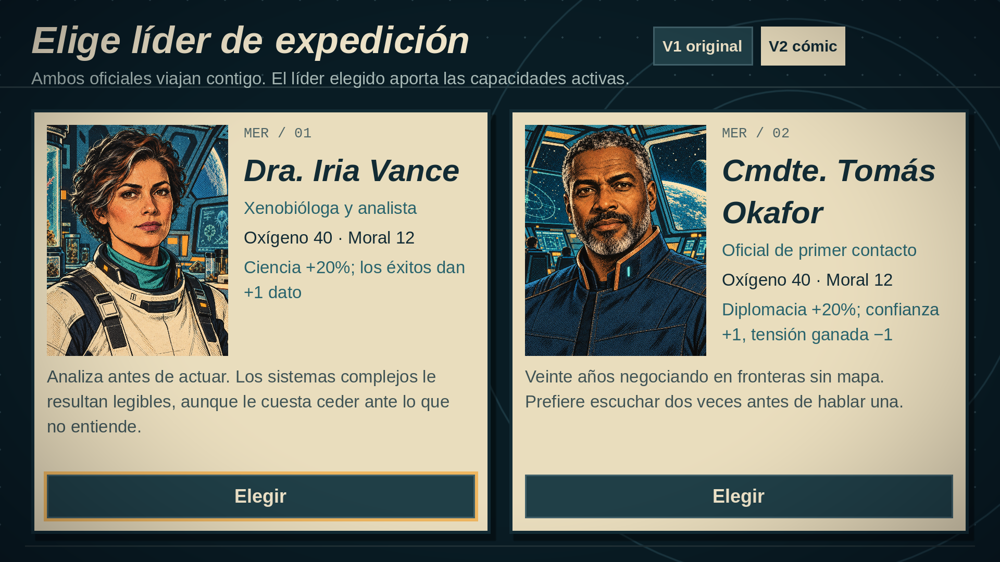

# Leyendas Estelares / Stellar Legends

Mini juego open source de **exploración espacial narrativa** hecho con [Godot](https://godotengine.org) 4 (multiplataforma).
Disponible en **español e inglés** (cambio de idioma desde el título).

Capitanea la nave *Meridiana* a través de un sector desconocido, siguiendo un pulso de tres tonos hasta su origen.
Decides a dónde saltar, hablas con otras formas de vida y exploras la superficie de los planetas.
Tono serio, de ciencia ficción exploratoria: primer contacto, dilemas éticos, prudencia.



## Cómo se juega

El juego tiene tres capas:

1. **Mapa estelar (estilo *FTL*).** Cada salto gasta **combustible** (las rutas largas cuestan 2). Los nodos
   aparecen como «?» hasta que los **escaneas**: un escaneo revela el tipo de nodo y qué hay en un planeta
   (ruinas, señales, restos, vida, combustible). Si te quedas sin combustible lejos del destino, la campaña termina.
2. **Comunicaciones de primer contacto.** Tres especies con valores distintos: los **Vael** (franqueza),
   el **Gremio de Hallen** (cautela) y el **Dominio Draeth** (firmeza). Cada respuesta es una *postura*
   (abierta, cauta, firme, engañosa) que sube o baja **confianza** y **tensión**. Según las barras
   terminas en alianza, acuerdo, distancia prudente u hostilidad. La Dra. Vance analiza qué valora cada especie;
   el Cmdte. Okafor templa la tensión.
3. **Exploración de planetas** (estilo *The Curious Expedition*). Mapa hexagonal con niebla, oxígeno que se
   gasta según el terreno, puntos de interés con decisiones (a veces arriesgadas) y un objetivo que alcanzar
   antes de volver a la nave.

Lo que haces en una capa afecta a las otras: banderas y reputación (Concordato, Vael) abren o cierran opciones
más adelante y cambian el epílogo.

**Tripulación y bodega.** Vance y Okafor viajan juntos. Desde **Equipo y bodega**, en el mapa estelar,
eliges quién lidera la expedición: su especialidad aporta +20 puntos porcentuales a las acciones
correspondientes. Ambos tienen 40 de oxígeno. Vance obtiene datos adicionales al acertar acciones
científicas; Okafor mejora la confianza inicial y reduce la tensión ganada. Solo se activan las
capacidades del líder asignado. La moral es compartida; cambiar de líder no la recarga.

**Objetos y comercio.** Comienzas con un cartucho de oxígeno y unas raciones. También puedes recuperar
objetos en pecios y sondas. Los cartuchos recuperan 12 de oxígeno en superficie; las raciones, 3 de moral;
las celdas, 2 de combustible a bordo; las sondas, 2 escaneos a bordo. El equipo de prospección aporta
+10 puntos porcentuales en acciones arriesgadas (máximo 95 %) y el traductor añade 1 de confianza al
iniciar futuros contactos. Estas dos mejoras se activan al llevarlas y no se acumulan.

Tras un acuerdo o una alianza puedes **abrir el canal de comercio** antes de abandonar el contacto.
Cada especie tiene un catálogo y existencias limitadas. Pagas con datos científicos; también puedes
vender objetos de su catálogo. Una alianza reduce cada precio de compra en 1 dato. Los contactos
hostiles o distantes no comercian. Reabrir el mercado conserva sus existencias y no repite recompensas.
Los suministros se usan desde la bodega, nunca se consumen si el recurso ya está lleno. Una celda de
reserva permite repostar antes de que una nave sin combustible se dé por perdida.

**Controles:** ratón (clic) en todo; en el mapa de superficie también teclado: `Q` `E` (arriba), `A` `D` (lados),
`Z` `C` (abajo). En los menús, Tab, las flechas y Enter. `F11` cambia la pantalla completa y `M` silencia
el sonido. También hay un botón de sonido en el título; el idioma y el silencio se guardan entre sesiones.
En pantallas táctiles se juega tocando los controles, en horizontal; los paneles largos permiten desplazamiento.

**Estilo de retratos:** los botones **V1 original / V2 cómic**, disponibles en el título y al elegir líder,
cambian entre las dos colecciones. V2 está seleccionada por defecto. La elección se guarda y se aplica
a la tripulación, las tres especies y el comercio; puedes compararlas sin reiniciar el juego.

## Ejecutar

Versión validada: **Godot 4.7.2**, renderizador Compatibility. No requiere complementos ni servicios en línea.

```
godot --path . --import      # solo la primera vez (o abre el proyecto una vez en el editor)
godot --path .
```

Desde el editor: abre `project.godot` y pulsa *Play* (F5).

## Exportar

`export_presets.cfg` incluye Linux x86_64, Windows x86_64, macOS universal, web y Android
(arm64 y x86_64). Instala las plantillas de exportación de la **misma versión de Godot**.
Android necesita además un JDK 17, el SDK Android y la clave de depuración configurados en el editor.

```sh
python3 tools/export.py --godot /ruta/al/ejecutable/Godot  # todas las plataformas
python3 tools/export.py linux web --godot /ruta/al/ejecutable/Godot
```

El script guarda los paquetes y una copia de `LICENSE` en `build/<plataforma>/`, excluye pruebas y
herramientas del juego, y usa temporales locales para evitar cuotas de `/tmp`. `build/` no se versiona.
Los ejecutables de escritorio se exportan en modo release; el script general genera un **APK Android de depuración**
con paquete `.debug`, separado de la aplicación de distribución. Para el APK/AAB firmado, usa el flujo siguiente.
macOS lleva firma local ad hoc y Windows se genera sin firma de distribución. Publicar en tiendas y firmar con credenciales
propias son pasos independientes.

Para jugar a la exportación web desde el navegador:

```sh
python3 -m http.server 8000 --directory build/web
# abre http://localhost:8000 (no index.html mediante file://)
```

La web usa un solo hilo, incluye un manifiesto PWA y funciona con controles táctiles. El audio del navegador
puede empezar tras la primera interacción. La ejecución se verifica en Linux y Chromium; las exportaciones
de Windows y macOS requieren pruebas en sus sistemas nativos. Android cuenta con una campaña completa
en emulador; la revisión física y el consumo de batería siguen pendientes.

## Distribución firmada de Android

Los perfiles **Android Release APK** y **Android Release AAB** exportan la versión 1.1.0 (código 2),
con SDK mínimo 24, objetivo 36 y bibliotecas ARM de 32 y 64 bits. Incluyen iconos adaptativos propios.

```sh
python3 tools/android_release.py init-key --java-home /ruta/jdk17  # solo una vez
python3 tools/android_release.py export --godot /ruta/godot --java-home /ruta/jdk17
```

La clave y `signing.json` se guardan en `~/.local/share/leyendas-estelares/signing/`, fuera del repositorio,
con permisos privados. Conserva una copia segura de esa carpeta: las futuras actualizaciones deben
usar la misma identidad de firma. Para una clave existente, configura allí su ruta, alias y contraseña;
el script los pasa a Godot mediante variables de entorno, sin publicarlos en la línea de comandos.

Los archivos quedan en `build/android/release/`, junto a sus hashes y verificaciones de firma/alineación.
El script instala la plantilla Gradle si falta. La primera compilación puede descargar dependencias.
Se ha validado también el AAB con [bundletool](https://github.com/google/bundletool/releases/tag/1.18.2).
Generar estos archivos no los publica en ninguna tienda.

## Verificación nativa de Android

`python3 tools/android_smoke.py --serial SERIE --adb /ruta/adb` instala el APK en el dispositivo
indicado, comprueba el arranque, detecta errores de shaders y guarda captura y registro en
`build/android/validation/`. No selecciona teléfonos automáticamente ni borra sus datos. El dispositivo debe estar desbloqueado;
la comprobación exige además un renderizador inicializado y la aplicación en primer plano. Para el APK
firmado, añade `--package org.leyendasestelares.game --apk build/android/release/leyendas-estelares.apk`.

El error `GL_MAX_FRAGMENT_UNIFORM_VECTORS (261)` observado en SwiftShader coincide con
[Godot #109550](https://github.com/godotengine/godot/issues/109550): su compilador OpenGL ES por
software presenta incompatibilidades. Para contrastarlo, usar un emulador con GPU del host
(`-gpu host`), ANGLE (`-gpu swangle`) o un dispositivo físico. El emulador con ANGLE
ha completado una campaña nativa con esta versión. No se considera superada la validación por el mero hecho
de generar el APK; el script falla ante errores gráficos. La validación de una partida completa,
reanudar tras interrupciones y el consumo en un teléfono se documentan por separado.

## Prueba Android de una campaña completa

El perfil **Android QA** usa el mismo juego con un observador de solo lectura, dentro de un paquete
`.qa` independiente. El controlador pulsa y arrastra mediante ADB; el observador no ejecuta acciones.

```sh
godot --headless --path . --export-debug "Android QA"
python3 tools/android_playthrough.py --serial SERIE --adb /ruta/adb
```

Guarda capturas, acciones y un informe en `build/android/playthrough/`. Comprueba Atrás, Home/reanudación,
audio suspendido, recuperación exacta tras `force-stop`, navegación, contactos, comercio y superficie.
El planificador de la prueba puede consultar el mapa completo para elegir el recorrido. La escena QA
se excluye de los paquetes normales y de distribución.

Android limita el renderizado a 30 FPS. La campaña nativa de referencia terminó en victoria con cinco
saltos y 36 movimientos en el emulador Android 17 con ANGLE a 960×540; también pasó una compra y el
arrastre sobre botones. No sustituye una medición de autonomía, temperatura y fluidez en un teléfono:
la prueba física quedó pendiente porque el dispositivo conectado estaba bloqueado.
El [informe de referencia](docs/android/report.json) y las [capturas nativas](docs/android/ending-victory.png)
registran el alcance y el resultado de la comprobación.

## Ayuda para decidir

La superficie dibuja la ruta de menor coste de vuelta a la nave usando únicamente terreno descubierto.
El HUD muestra su coste de oxígeno y avisa cuando queda poco margen; los eventos pueden cambiar
ese cálculo. Las decisiones anticipan recursos, probabilidades y consecuencias narrativas. El botón
**?** abre una guía de terrenos, recursos y contactos mientras la partida queda en pausa.

## Cartografía de tinta y papel

La superficie y el mapa estelar usan símbolos SVG propios en `art/cartography/`, con líneas nítidas,
paletas diferenciadas por bioma y marcadores coherentes con la interfaz retro. Los sprites originales
se conservan en `art/`; las versiones de retratos siguen disponibles desde el selector de estilo.

## Líderes con capacidades distintas

Ambos oficiales disponen de 40 de oxígeno y comparten la moral de la tripulación. Vance añade
un dato a cada acción científica exitosa y conserva su bonificación de probabilidad. Okafor empieza
los contactos con una unidad adicional de confianza y reduce en uno la tensión positiva. Estas
ventajas dependen del líder activo, que se cambia a bordo antes del siguiente encuentro.

## Consecuencias que viajan contigo

Tres cadenas enlazan seis nuevos eventos con rescates, señales Vael y depósitos del gremio.
Las transmisiones llegan tras saltos posteriores, pueden abrir opciones según promesas anteriores
y se intercalan antes del destino sin sustituirlo. La **Bitácora** de la bodega conserva las decisiones;
el final recoge sus consecuencias y las transmisiones que quedaron pendientes. La cola, los resultados
y la bitácora se guardan junto con la expedición.

## Diplomacia contextual

Las preferencias culturales son una orientación. Cada intercambio introduce una situación distinta:
privacidad, pruebas, ofertas o compromisos. Repetir una postura reduce la confianza y puede aumentar
la tensión. Las respuestas muestran sus efectos y el coste en datos antes de elegirlas; el motor
rechaza pagos que no se pueden afrontar. El historial de posturas forma parte del guardado.

## Interfaz táctil

Android activa botones de al menos 48 unidades lógicas, desplazamiento de paneles y controles
de dirección con el coste de cada movimiento. El mapa estelar separa los objetivos táctiles.
La composición mantiene sus proporciones en teléfonos y tabletas y respeta el área segura
del dispositivo. Puede revisarse en escritorio con `godot --path . -- --touch-ui`.

## Guardado de expediciones

La partida se guarda después de cada decisión en `user://expedition.save`, con escritura temporal,
verificación de integridad y una copia de respaldo. **Continuar partida** recupera ruta, inventario,
mercados, superficie, niebla, conversaciones y resultados pendientes. Una nueva expedición pide
confirmación antes de sustituir la anterior; terminarla elimina su guardado. Los archivos son locales
al dispositivo. Atrás en Android o Esc en escritorio cierra primero la bodega o el mercado;
en una expedición abre el menú de pausa. Al cambiar de aplicación se guarda inmediatamente,
se suspende el audio y se requiere reanudar de forma explícita. El silencio elegido se conserva. Las partidas y sus copias no se incluyen en Git ni en las exportaciones.

## Traducciones

Todos los textos están en **`translations/strings.csv`** (formato estándar de Godot: `keys,en,es`).
Los JSON de `data/` solo contienen mecánica; el texto se busca por claves con nombre convencional:

| Texto | Clave |
|---|---|
| Evento | `event.<id>.title`, `.text`, `.c<i>.text`, `.c<i>.ok` / `.fail` / `.res`, `.c<i>.hint` |
| Encuentro | `contact.<id>.intro`, `.x<n>.prompt`, `.x<n>.o<i>`, `.x<n>.o<i>.reply`, `.out.<desenlace>` |
| Planeta, avatar, especie | `planet.<id>.name/intro/...`, `avatar.<id>.name/...`, `species.<id>.name/desc` |
| Interfaz | `ui.*`, `fx.*`, `ending.*` |

Los parámetros se escriben `{nombre}`. En el código se usa `T.t("clave", {"nombre": valor})`.

**Añadir un idioma:** añade una columna con su código (p. ej. `fr`) al CSV y una entrada en `T.LANGUAGES`
(`scripts/t.gd`). Las pruebas avisan de cualquier clave sin traducir, parámetros que no coinciden entre idiomas
y claves sin uso.

## Pruebas

```
godot --headless --path . res://tests/run_tests.tscn   # lógica, datos, traducciones y bots de campaña
godot --headless --path . res://tests/save_test.tscn    # recuperación e idempotencia del guardado
godot --headless --path . res://tests/ui_test.tscn      # recorre la interfaz con clics y teclas reales
```

`run_tests` valida datos y traducciones, genera cientos de mapas y sectores, comprueba las conversaciones y
simula campañas completas con un bot usando el mismo motor que la interfaz.
Incluye 600 campañas, cambio de líder, consumo y límites de objetos, mejoras, bloqueo por relaciones,
compras y ventas, existencias persistentes y protección contra recompensas duplicadas. Los bots compran
suministros y los usan durante la campaña. La prueba de UI también abre la bodega y los mercados.
El [informe de validación](docs/validation.json) registra resultados, límites y hashes de los paquetes locales.
Capturas (requiere display, p. ej. `xvfb-run`): `godot --path . res://tests/screenshot.tscn -- /ruta [en|es]`.

## Estructura

| Ruta | Contenido |
|---|---|
| `data/` | Mecánica en JSON: avatares, facciones, planetas, eventos, especies, encuentros, campaña, objetos y mercados |
| `translations/` | `strings.csv`: todos los textos (en, es) |
| `scripts/` | Lógica pura (`sector_data`, `campaign`, `planet_data`, `expedition`, `event_runner`, `contact_runner`, `game_state`) y UI (`scripts/ui/`) |
| `shaders/` | Viñeta y efecto de comunicación |
| `art/generated/` | 9 ilustraciones originales V1; prompts y hashes en `manifest.json` |
| `art/generated/v2_retro/` | 5 retratos V2 editados con el generador de imágenes: cómic americano retro de ciencia ficción; fuentes, prompts y hashes en su `manifest.json` |
| `art/fonts/` | Liberation Sans y Mono, con su licencia OFL incluida |
| `art/cartography/` | Símbolos SVG retro para terrenos, objetos y mapa estelar |
| `art/` | Icono vectorial y sprites pixel art originales de `tools/gen_art.py`, conservados como colección de referencia |
| `audio/` | Ambiente espacial y 8 señales originales sintetizadas por `tools/gen_audio.py` |
| `tools/export.py` | Exportaciones reproducibles con los presets versionados |
| `tests/` | Pruebas headless, prueba de UI y capturas |

### Añadir contenido

- **Evento:** añádelo a `data/events.json` (cada opción tiene `result` o `risk`; opcional `tag` y `requires`),
  escribe sus textos en el CSV y añade su id al `event_pool` de un planeta o a `anomaly_pool` en `data/campaign.json`.
- **Encuentro:** añádelo a `data/encounters.json` con su especie, intercambios y desenlaces (`data/species.json`
  define cómo reacciona cada especie a cada postura).
- **Objeto:** añádelo a `data/items.json`, traduce `item.<id>.name/desc` y añádelo al catálogo de una especie en `data/markets.json`. Los eventos entregan objetos con `effects.items`.
- Regenerar los sprites tácticos: `python3 tools/gen_art.py`. Esto no sobrescribe las ilustraciones de `art/generated/`.
- Regenerar el sonido: `python3 tools/gen_audio.py` (solo biblioteca estándar de Python).

## Arte y sonido

Las ilustraciones están integradas en el título, la selección de tripulación, las comunicaciones,
el comercio y los briefings de descenso. Los PNG originales se guardan dentro del proyecto;
`art/generated/manifest.json` documenta los prompts exactos y la herramienta utilizada. No se necesita
generar imágenes ni disponer de una clave de API para ejecutar el juego.

La **V2 cómic** reinterpreta los cinco retratos originales mediante tinta, tramas de impresión y una
paleta de azul petróleo, marfil y ámbar. Conserva los personajes, sus rasgos y vestuario. Los originales
no se sobrescriben: `art/generated/manifest.json` documenta V1 y
[`art/generated/v2_retro/manifest.json`](art/generated/v2_retro/manifest.json) recoge los prompts exactos
de edición, las referencias y los hashes de ambas versiones. Se utilizó la herramienta integrada
`image_gen` de OpenAI.

La interfaz acompaña esta dirección con fichas de tripulación sobre papel, titulares nuevos, retratos
de contacto ampliados, mapa de navegación con rutas discontinuas y pictogramas vectoriales propios
para los suministros. Las fuentes Liberation se distribuyen con su [licencia OFL](art/fonts/LICENSE).



El ambiente y las señales de clic, paso, escaneo, salto, suministro, comercio, alerta y pulso de tres tonos
son síntesis original reproducible; no incorporan grabaciones ni música de terceros.

## Hoja de ruta

- [x] Fase 1: exploración de planetas (mapa hexagonal, recursos, eventos con decisiones)
- [x] Fase 2: mapa estelar con combustible y escaneos, 3 especies con comunicaciones, 3 planetas con biomas, español/inglés
- [x] Fase 3: tripulación como equipo, objetos, botín y comercio con las tres especies
- [x] Fase 4: ilustraciones propias generadas, sonido, pulido de interfaz y exportaciones locales (PC, Android y web)
- [ ] Distribución pública: pruebas físicas en Windows/macOS/Android, firma de escritorio y publicación en tiendas si se desea

## Licencia

GPL v2 (ver `LICENSE`).
